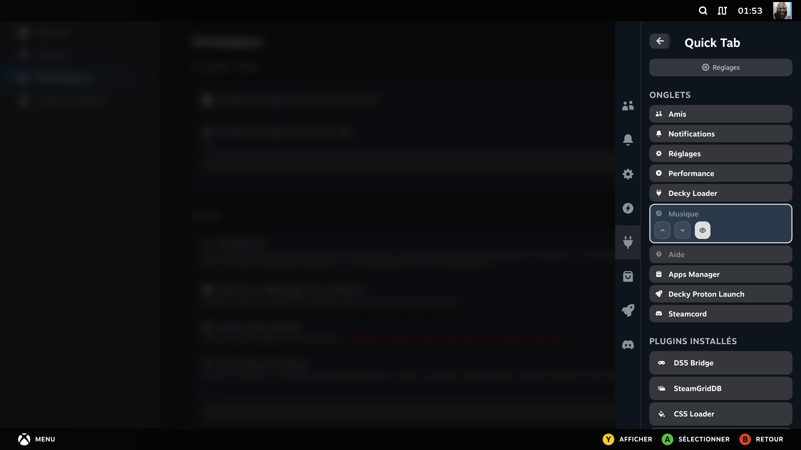
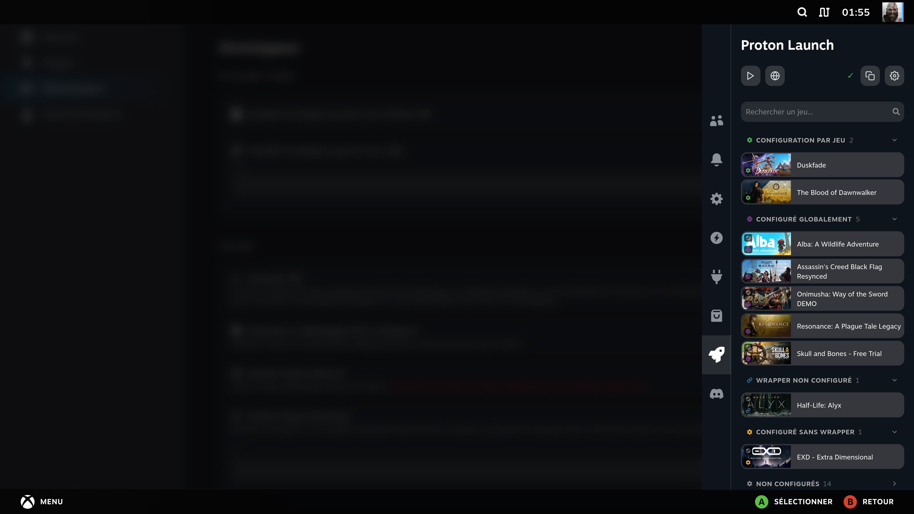

# Quick Tab


**Pin your own plugins directly into Steam's Quick Access Menu.**

Quick Tab adds each of your installed Decky plugins as its own icon in the Quick Access Menu's native tab bar, instead of going through Decky Loader's own aggregated plugin list. Reorder every tab — native, Decky's own, and pinned plugins alike — and hide the native ones you don't use.

### ✨ New in 0.1.0

- Pin your own plugins directly into Steam's Quick Access Menu tabs
- Reorder and hide native tabs (Notifications, Chat, Help, Music)
- Settings page: plugin self-update, bug report, feature request, support the development

---

## Screenshots

### Every tab in one place

Native tabs, hide/reorder controls, and your installed plugins ready to pin — all from one panel.



### A pinned plugin, opened directly from its tab

Decky Proton Launch running in its own Quick Access Menu tab, no different from a native one.



---

## Features

- **Pin any installed plugin** as its own icon in the Quick Access Menu tab bar
- **Reorder every tab** — native, Decky's own, and pinned plugins alike
- **Hide native tabs** you don't use (Notifications, Chat, Help, Music)
- **Settings page**: check for plugin updates and install in one click, report a bug or request a feature via QR code, discover your other plugins, support the development
- **Gamepad navigation**: fully accessible with the Steam Deck controller
- **Multi-language support**: EN, FR, DE, ES, IT, PT-BR, PT-PT, RU, PL, NL, TR, UK, JA, KO, ZH-CN

---

## Installation

Download the latest release zip from the [Releases page](https://github.com/moi952/decky-quick-tab/releases/latest) and load it via Decky Loader, or build from source:

1. Clone the repository:

```bash
git clone https://github.com/moi952/decky-quick-tab.git
```

2. Install dependencies:

```bash
sudo npm install -g pnpm@9
pnpm install
```

3. Build the plugin:

```bash
pnpm run build
./package.sh
```

4. Load the plugin via Decky Loader.

---

## Contributing

Contributions are welcome!

- **New language**: add a JSON file in `src/i18n/locales/` following the existing structure and open a PR.
- **Bug or feature idea**: open an issue, or use the QR code shortcuts in the plugin's own Settings page.

---

## License

BSD-3-Clause License
